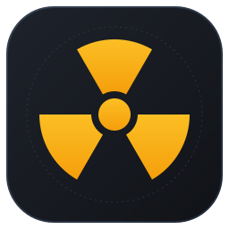

# Curie-DAQ

<div align="center">
  
  <h3>Modern Nuclear Physics Data Acquisition & Analysis</h3>
  <p>Geiger-Müller counter DAQ, Poisson/decay curve fitting, and spatial sweeps for educational and research physics laboratories.</p>

  [](https://github.com/CokieMiner/Curie-DAQ/releases)
  [](https://www.rust-lang.org/)
  [](LICENSE)
  []()
</div>

---

**Curie-DAQ** is a cross-platform data-acquisition and statistical analysis application for nuclear radiation experiments. Designed as a modern, high-precision replacement for legacy DOS software such as PHYWE `RADIO1` and `RADIO2`, it interfaces natively with **PHYWE Cobra3** hardware over RS-232 / USB-serial as well as streaming microcontroller pulse counters.

> **Status:** Fully verified and benchmarked on physical lab hardware (**PHYWE Cobra3** over RS-232 / USB-serial and Windows 7 64-bit / Linux x86_64). Production-ready for university physics laboratory practicals.

---

## Downloads & Installation

Pre-compiled standalone binaries are available on the [**GitHub Releases**](https://github.com/CokieMiner/Curie-DAQ/releases) page:

* **Windows 7 / 8 / 10 / 11 (64-bit):** Download `curie-daq-v0.1.0-windows-x86_64.zip`. Extract anywhere and run `curie-daq.exe`.
  * *Note on Windows 7 / Legacy Intel Graphics:* The zip includes `opengl32.dll` (Mesa software rasterizer). Keeping it next to `curie-daq.exe` bypasses legacy OpenGL driver crashes and rendering artifacts on older hardware.
* **Linux (x86_64):** Download `curie-daq-v0.1.0-linux-x86_64.tar.gz`. Extract and run:
  ```bash
  chmod +x curie-daq
  ./curie-daq
  ```

---

## What it does

* **PHYWE Cobra Hardware Timing:** RS-232 / USB-serial (9600 or 19200 baud, 8N1). The Cobra interface times every gate autonomously with microsecond quartz precision (`Z` command), making count gates completely independent of OS scheduling, rendering, or window visibility.
* **Auto-Connect & Port Discovery:** Defaults to `COM1` on Windows with silent background reconnect retries when connecting bench equipment.
* **Streaming Counter Support:** Ingestion for ASCII line counters (e.g. Arduino, GMC) and raw byte streams with fixed gate deadlines.
* **Integrated Simulator:** Practise and test experiments without physical radioactive sources: Poisson counting, half-life decay (Pa-234m preset), and inverse-square attenuation.
* **Gate Series (1:ACQUIRE):** Flexible gate duration $\Delta t$, unbounded gate count (overcoming RADIO1's 1000-gate limit), live mean $\mu \pm \sigma_\mu$, variance, Fano factor, time series rate chart, and integer histogram with theoretical Poisson distribution overlay.
* **Guided Sweeps (2:SWEEP):** Heterogeneous distance (mm) or angle (°) coordinate sweeps with customizable multi-state bench configurations (e.g., *No filter*, *Al cap*, *Pb shield*), repeat steps, and undo support.
* **Analysis & Fitting (3:ANALYSIS):**
  * **Exponential Decay:** Poisson maximum-likelihood fit of $A \cdot e^{-\lambda (t - t_0)} + B$ on raw gate counts, with background fitted or fixed to measured zero-effect. Computes $\lambda$, $T_{1/2}$, $R(t_0)$, $B$ with formal error propagation and $\chi^2/\text{ndf}$.
  * **Gaussian & Poisson Distributions:** Unbiased parameter estimation ($\mu$, $\sigma$, FWHM, $\lambda$ with standard errors) and Pearson $\chi^2$ goodness-of-fit testing with automatic bin merging ($\ge 5$ expected events per group).
  * Theoretical conventions and formulas are detailed in [`STATISTICS.md`](STATISTICS.md).
* **Automated Data Preservation:** Every recorded gate is immediately flushed to an autosave CSV (in `~/curie_runs`). Saved sessions persist between application restarts, tagged with metadata headers (start timestamp, hardware channel, dead time, tube voltage).
* **Display Optimization:** Native 1200×680 layout (minimum 960×540), engineered to fit legacy 1366×768 lab monitors without overflowing the taskbar.

---

## Building from Source

Requirements: Rust 1.95 or newer.

```bash
# Clone the repository
git clone https://github.com/CokieMiner/Curie-DAQ.git
cd Curie-DAQ

# Build and run on Linux
cargo run --release -p curie-ui

# Build Windows 10/11 release binary from Linux (requires mingw-w64)
rustup target add x86_64-pc-windows-gnu
cargo build --release --target x86_64-pc-windows-gnu -p curie-ui
# -> target/x86_64-pc-windows-gnu/release/curie-daq.exe

# Build statically-linked Windows 7 binary (Rust tier-3 target)
rustup component add rust-src --toolchain nightly
RUSTFLAGS="-C link-arg=-static" cargo +nightly build --release -Z build-std=std,panic_unwind --target x86_64-win7-windows-gnu -p curie-ui
# -> target/x86_64-win7-windows-gnu/release/curie-daq.exe
```

### Linux Serial Permissions

Ensure your Linux user belongs to the `dialout` group (`uucp` on Arch Linux):

```bash
sudo usermod -a -G dialout $USER
```

---

## Experimental Workflows

1. **Hardware Connection (4:CONFIG):** Select *DEVICE: PHYWE COBRA*, pick the serial port (e.g. `COM1` or `/dev/ttyUSB0`), baud rate (9600), and click **CONNECT** (or let auto-connect establish the link). The status changes to *PHYWE COBRA ONLINE*. Choose the detector profile (presets or *CUSTOM* with measured dead time).
2. **Background & Counting Statistics (1:ACQUIRE):** Set gate $\Delta t$ (e.g. 10 s) and gate target. Click **START**. Switch to *DISTRIBUTION* to observe the live histogram. In **3:ANALYSIS**, fit Gaussian or Poisson distributions to evaluate $\chi^2/\text{ndf}$ and goodness-of-fit.
3. **Attenuation & Inverse Square Law (2:SWEEP):** Select axis *DISTANCE*, name bench states (*STATE NAMES…*), and step through distances with **START STEP**. The summary table computes differential net counts with propagated uncertainties.
4. **Half-Life Measurement (e.g. Pa-234m / Bq):** In **1:ACQUIRE**, acquire continuous gates across multiple half-lives. In **3:ANALYSIS → Exponential**, set the decay start point $t_0$ and solve for half-life $T_{1/2}$.

---

## CSV Export Format

```csv
# Curie-DAQ gate series
# started_utc: 2026-11-16T18:00:00Z
# source: PHYWE COBRA on COM1 @ 9600 baud (gates timed by the device)
# gate_s: 10
# detector: PHYWE 09005.00 | dead_time_us: 100.0 | tube_voltage_V (operator note): 500
# t_mid_s = gate centre since start; rate = counts/gate_s; rate_sigma = sqrt(max(counts,1))/gate_s
index,t_mid_s,gate_s,counts,rate_cps,rate_sigma_cps,rate_deadtime_corrected_cps
0,5.030,10,9,0.900000,0.300000,0.900081
```

---

## Architecture

```
crates/
├── curie-core/   # #![no_std] + alloc, zero dependencies
│   ├── acquisition   Fixed-deadline gate sessions & hardware-timed gate ingestion
│   ├── analysis/     Decay ML fit, Gaussian/Poisson fits, Pearson chi-squared
│   ├── hardware/     Device contract, Cobra protocol, MCU counter, detector profiles
│   ├── math          Bit-accurate f64 math (sqrt, exp, ln, normal CDF, Poisson pmf)
│   ├── stats/        Welford running moments, integer-aligned histograms
│   ├── storage       Dataset storage and registry
│   └── sweep         Position-by-state sweep sessions (distance or angle)
└── curie-ui/     # eframe/egui desktop app (binary: curie-daq)
```

The workspace complies with strict Clippy restrictions (`unsafe_code = "deny"`, `unused_results = "deny"`, `clippy::pedantic`) and passes 51 comprehensive tests:

```bash
cargo test --workspace
cargo clippy --workspace --all-targets
```

---

## License

Apache-2.0. Author: Pedro Martins.
